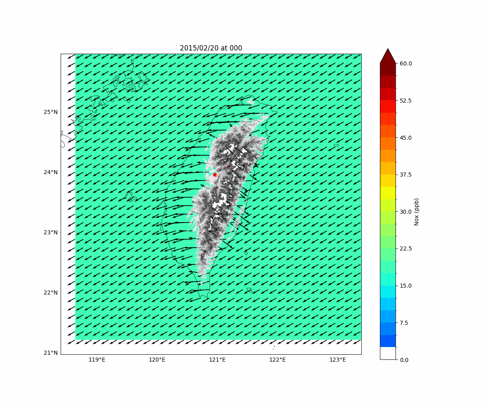

# EMISAT-AirQuality-Analysis

This repository contains advanced Python scripts designed to process, analyze, and visualize high-resolution regional model outputs (e.g., EMISAT simulation archives). The scripts handle multidimensional NetCDF datasets to investigate pollutant transport, planetary boundary layer (PBL) dynamics, and vertical chemical distributions ($NO_x$ and $NO_2/NO_x$ ratios) over complex topography (Taiwan region).

---

## Key Modules & Features

### 1. Surface Pollutant Distribution & Wind Field Animation (`atm-1.gif`)
* **Spatial Mapping:** Utilizes Cartopy (`PlateCarree` projection) to plot high-resolution topography, coastlines, and grid coordinates.
* **Dynamic Quiver Vectors:** Overlays horizontal wind vectors ($u, v$) sampled at surface terrain indices, combined with custom contour colormaps (`ListedColormap` with `BoundaryNorm`) for nitrogen oxides ($NO_x$).
* **Temporal Evolution:** Implements `matplotlib.animation.FuncAnimation` to generate time-series GIF animations tracking hourly pollutant accumulation and transport.

### 2. Vertical Cross-Section & Planetary Boundary Layer (PBL) Diagnosis
* **Cross-Sectional Slicing:** Extracts latitude-longitude slices across specific urban/geographical transects (e.g., Taichung/Taiping regions).
* **PBL Height Estimation:** Computes potential temperature ($\theta$) profiles to diagnose the boundary layer top using the standard threshold method ($\theta \ge \min(\theta) + 0.5\text{ K}$).
* **Topographic Masking:** Applies terrain masking (`masked_where`) to accurately shade out subterranean grid points.

### 3. Column-Integrated Mass Density & Chemical Ratios
* **Vertical Integration:** Computes air density and layer thicknesses ($\Delta z$) to calculate the vertically-integrated $NO_x$ mass density ($\text{mg/m}^2$).
* **Chemical Regime Analysis:** Evaluates spatial variations in the $\text{NO}_2/\text{NO}_x$ ratio to infer photochemical aging and emission source proximity.
